<div align="center">

# 🔥 Diarco

**Bitácora diaria, horario semanal y hábitos con rachas, en una app amigable y lúdica.**

Next.js 16 · React 19 · Tailwind CSS 4 · Supabase · TanStack Query · Turborepo

**[Ver Diarco en vivo → diarco.vercel.app](https://diarco.vercel.app)**

</div>

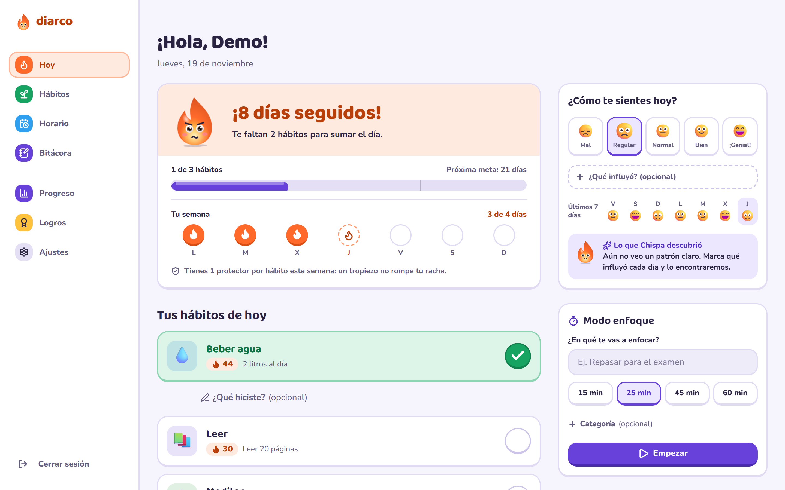

Diarco te ayuda a sostener lo que quieres repetir: marcas tus hábitos del día, anotas lo que
hiciste, organizas tu semana tipo y ves tu progreso. Chispa, la llamita de tu racha, te acompaña
y celebra contigo cada día cumplido.

## Qué puedes hacer

| | |
|---|---|
| **Hoy** | Racha general, progreso del día, hábitos para marcar, agenda, ánimo y modo enfoque. |
| **Hábitos** | Hábitos con días de la semana, meta, ícono y color. Racha y mejor marca por hábito. |
| **Rutina** | Tareas de cada día sin hora ni racha (tender la cama, lavar los platos): se marcan en Hoy sin presión. |
| **Pendientes** | Tareas y eventos de una sola vez, con o sin fecha y hora. Lo atrasado sigue apareciendo en Hoy. |
| **Horario** | Semana tipo con bloques por categoría, vista semana o día y "ahora mismo". |
| **Bitácora** | Lo que hiciste cada día, con hora, minutos y categoría. |
| **Progreso** | Cumplimiento diario, por día de la semana y por hábito; tiempo por categoría y ánimo. |
| **Logros** | 109 medallas en 6 grupos, con las que estás por ganar al frente. |
| **Modo enfoque** | Pantalla completa con Chispa como una vela que se consume, frases de ánimo, sonido ambiente (fogata o lluvia), contador de distracciones, aviso al terminar y descansos automáticos. Cada sesión se anota en la bitácora. |
| **Ánimo** | Cómo te sentiste y qué influyó; Chispa cruza tu ánimo con tus hábitos y descubre patrones. |

Las rachas son amables: tu racha general suma con cumplir el 70 % de lo programado, y cada
hábito tiene protectores semanales para que un tropiezo no borre semanas de esfuerzo.

## Capturas

| Hábitos | Horario |
|---|---|
| 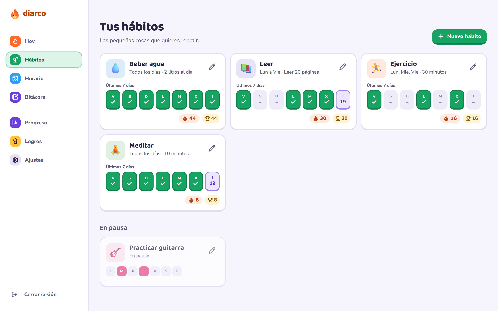 | 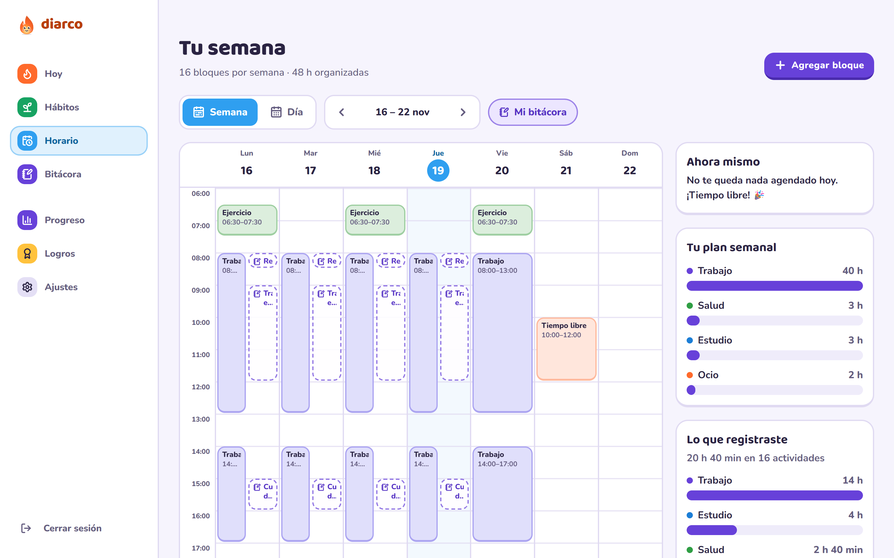 |
| **Bitácora** | **Progreso** |
| 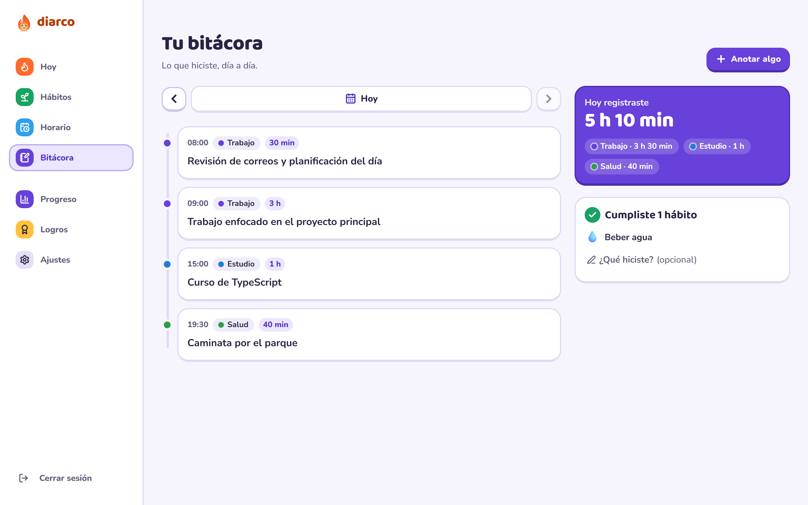 | 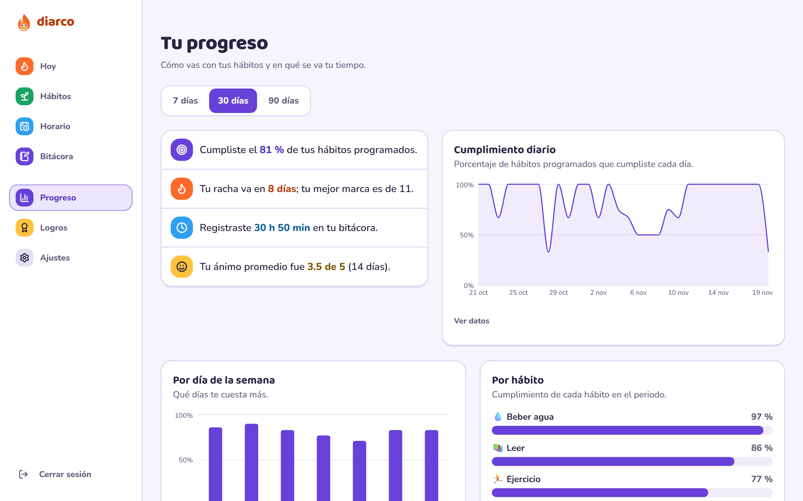 |
| **Logros** | **Modo oscuro** |
| 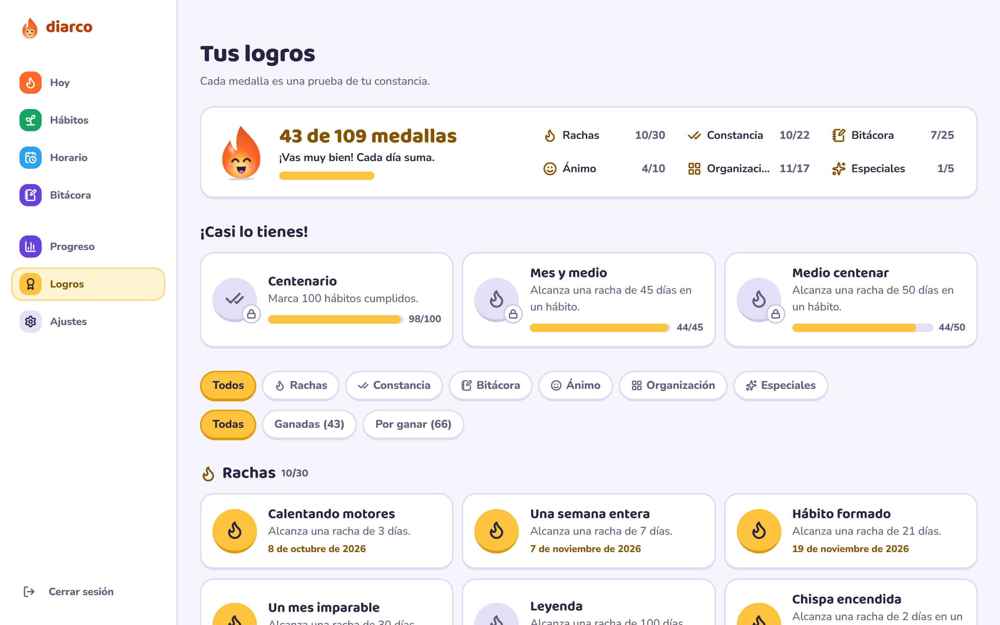 | 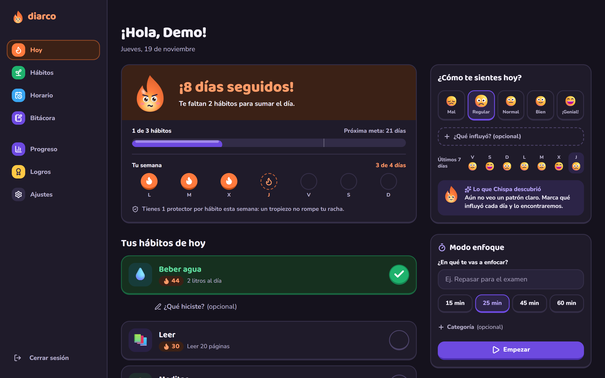 |

<p align="center">
  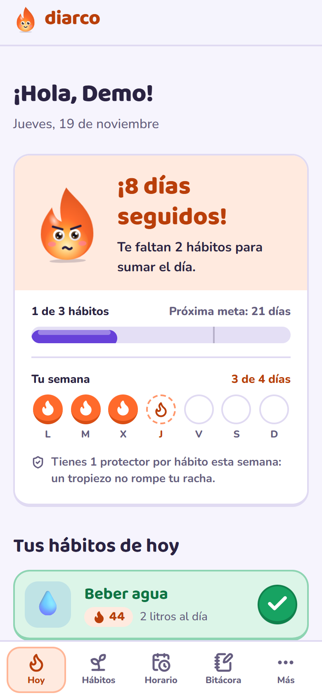
  &nbsp;&nbsp;
  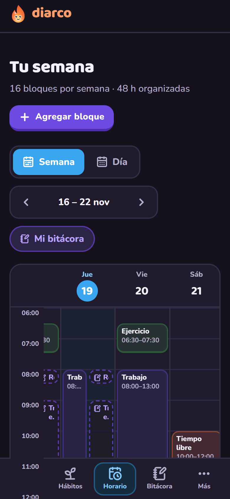
  &nbsp;&nbsp;
  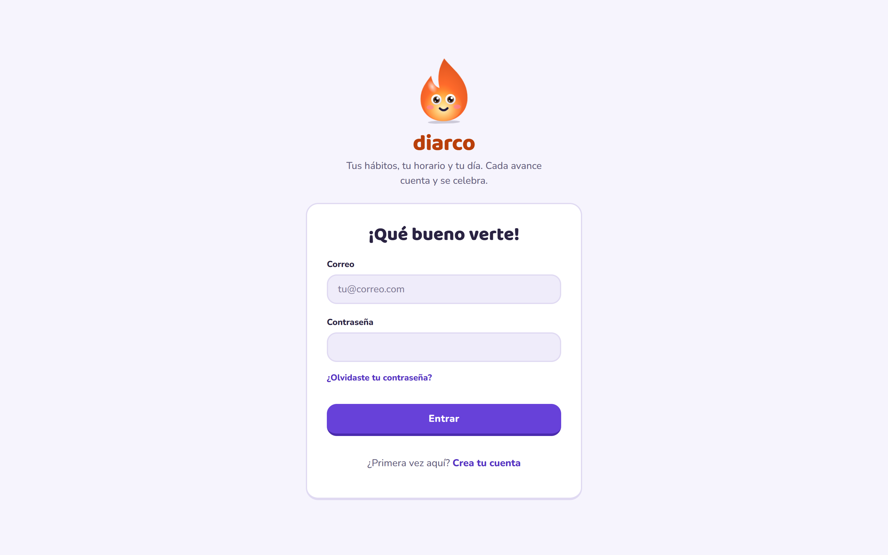
</p>

> Las capturas usan el usuario demo del `seed.sql`.

## Arquitectura

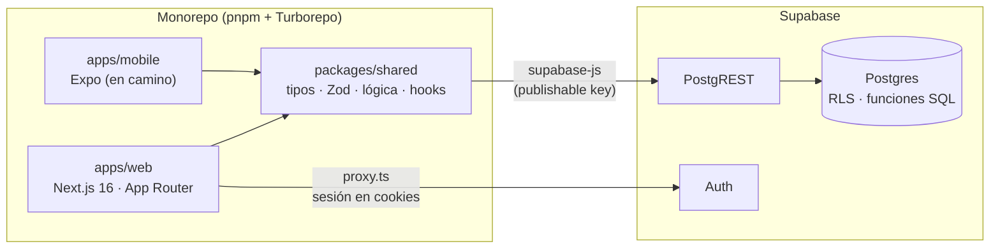

- **`packages/shared`** concentra todo lo que no es interfaz: esquemas Zod, cálculo de rachas,
  estadísticas y logros (funciones puras con pruebas en Vitest) y los hooks de TanStack Query.
  Web y móvil comparten la misma lógica.
- **Las pantallas nunca consultan Supabase directamente**: llaman a hooks que validan cada
  respuesta con Zod y traducen los errores de Postgres a mensajes en español.
- **La seguridad vive en la base**: todas las tablas tienen RLS con `auth.uid()`, claves foráneas
  compuestas impiden mezclar datos de dos usuarios y la app solo usa la publishable key.
- **`proxy.ts`** (el middleware de Next 16) refresca la sesión y protege las rutas privadas.

### Modelo de datos

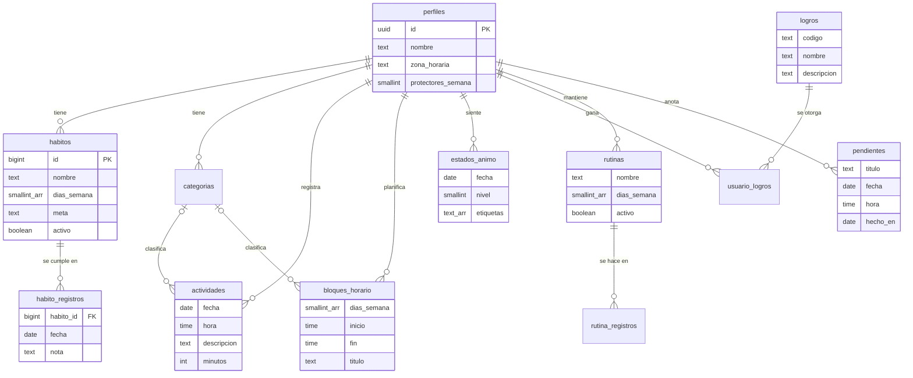

### Cómo se calcula una racha

Cada día se recorre en orden cronológico; solo cuentan los días en que el hábito estaba programado.

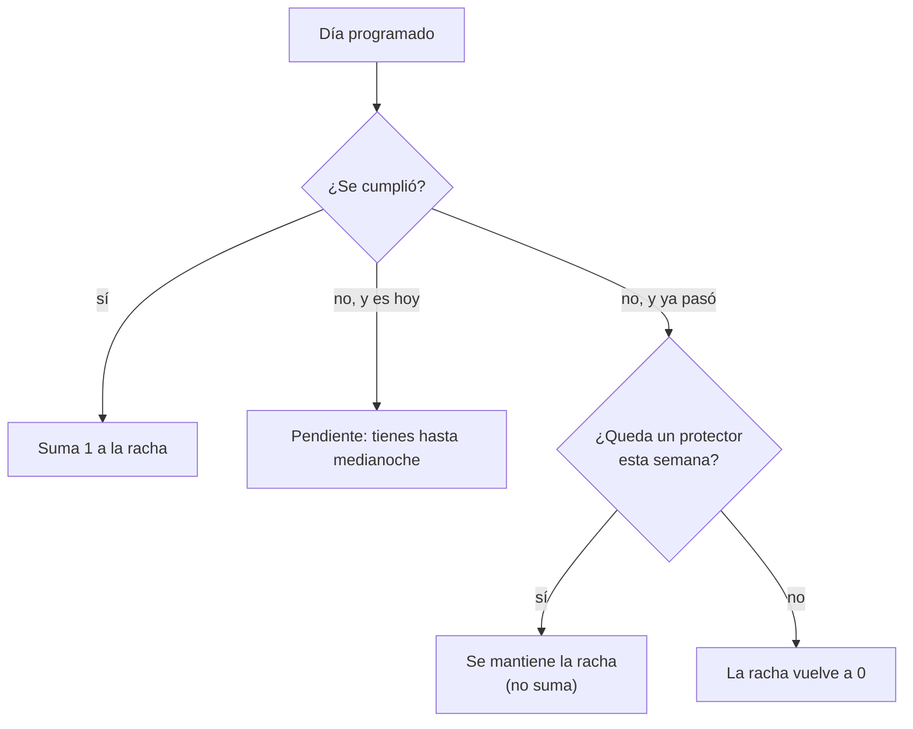

- **Racha de cada hábito**: sigue el diagrama, con los protectores semanales que elijas en Ajustes.
- **Racha general**: un día cuenta si cumpliste al menos el 70 % de los hábitos programados
  (lo calcula `resumen_diario` en SQL); no usa protectores.
- Las fechas se calculan en la zona horaria del usuario (no en UTC), así "hoy" es tu hoy.

## Estructura

```
apps/
  web/            Next.js: pantallas, componentes y proxy de sesión
  mobile/         Expo (base lista; la app llega en la etapa 5)
packages/
  shared/         @diarco/shared: tipos, Zod, lógica, consultas y hooks (+ Vitest)
supabase/
  migrations/     esquema, RLS, funciones de rachas, catálogo de logros
  templates/      correos de Auth en español
  seed.sql        usuario demo con 60 días de historia
docs/capturas/    imágenes de este README
```

## Calidad

- **110 pruebas unitarias** (Vitest) para rachas, estadísticas, logros, fechas, ánimo, rutina y pendientes.
- **Pruebas de punta a punta** (Playwright) que recorren todas las pantallas con el usuario demo.
- **Verificación de la base sin Docker** (`pnpm db:verificar`): aplica migraciones y seed en PGlite
  y comprueba RLS, restricciones y funciones SQL.
- **CI en GitHub Actions**: pruebas, tipos, lint, build, verificación de la base y e2e con
  Supabase local.
- Accesibilidad: objetivos táctiles de 44 px, foco visible, `prefers-reduced-motion`, contraste
  AA en claro y oscuro.

## Correr en local

Requisitos: Node 20+, pnpm 12 y (opcional) Docker para Supabase local.

```bash
pnpm install
pnpm db:start            # Supabase local con migraciones + seed (necesita Docker)
cp .env.example apps/web/.env.local   # y pega la URL y la publishable key que muestra db:start
pnpm dev:web             # http://localhost:3000
```

Entra con el usuario demo: `demo@diarco.local` / `diarco123`.

| Comando | Qué hace |
|---|---|
| `pnpm test` | Pruebas unitarias |
| `pnpm typecheck` · `pnpm lint` | Tipos y lint |
| `pnpm build` | Compila todo |
| `pnpm db:verificar` | Verifica migraciones, RLS y funciones sin Docker |
| `pnpm --filter @diarco/web e2e` | Pruebas de punta a punta |

## Despliegue

### 1. Base de datos (Supabase)

```bash
pnpm exec supabase link --project-ref <tu-project-ref>
pnpm exec supabase db push --remote
```

En el panel de Supabase → **Authentication → URL Configuration**:

- **Site URL**: `https://<tu-app>.vercel.app`
- **Redirect URLs**: añade `https://<tu-app>.vercel.app/**`

Y en **Authentication → Email Templates** pega las plantillas de `supabase/templates/`.

### 2. Web (Vercel)

1. En [vercel.com/new](https://vercel.com/new) importa el repositorio.
2. **Root Directory**: `apps/web` (Vercel detecta Next.js y el monorepo).
3. **Environment Variables**:

   | Variable | Valor |
   |---|---|
   | `NEXT_PUBLIC_SUPABASE_URL` | `https://<tu-project-ref>.supabase.co` |
   | `NEXT_PUBLIC_SUPABASE_PUBLISHABLE_KEY` | la publishable key (Settings → API Keys) |
   | `ENABLE_EXPERIMENTAL_COREPACK` | `1` (usa la versión de pnpm de `packageManager`) |

4. **Deploy**. Cada push a `main` vuelve a desplegar; cada pull request tiene su vista previa.

> Nunca uses la secret / service_role key en estas variables: todo lo que empieza con
> `NEXT_PUBLIC_` llega al navegador.

## Hoja de ruta

- [x] Esquema, RLS y funciones de rachas
- [x] Lógica compartida con pruebas
- [x] Web: Hoy, Hábitos, Horario, Bitácora
- [x] Web: Progreso, Logros, Ajustes, ánimo y enfoque
- [ ] App móvil con Expo y aviso "tu racha está en riesgo" a las 9 p. m.
- [ ] Publicación móvil con EAS
